<a href="https://aftershock-mk.vercel.app"></a>

<p align="center">
  <a href="https://aftershock-mk.vercel.app"></a>
  <a href="https://aftershock-mk.vercel.app/docs"></a>
  <a href="LICENSE"></a>
  <a href="CHANGELOG.md"></a>
  <a href="https://github.com/MaanavKrishna/Aftershock/actions/workflows/ci.yml"></a>
</p>

<p align="center">
  Aftershock turns a production incident into a regression test that must fail on the commit<br>
  before the fix and pass on the fix, three runs each in an isolated sandbox.<br>
  Then it guards every pull request against that incident coming back.
</p>

<h2></h2>


A postmortem says what broke and how it was fixed. It doesn't stop the next
change from breaking it again. Aftershock reads the incident and its fix,
drafts a test, and travels back in git history to prove it: the test must
fail on the commit before the fix and pass on the fix. Only then is it
admitted to memory, merged into your repository by pull request, and run
against every change that touches the same code.

Rules that never bend: a model never marks anything proven or safe, only test
runs do. A test that passes before the fix is rejected. Mixed results are
never green. Nothing is pushed to a default branch. Sandboxed runs get no
secrets and no network while tests run.

<h2></h2>

<p align="center">
  
  
</p>
<p align="center">
  
  
  
</p>
<p align="center">
  
  
</p>

Beyond the core loop: **Seen it before** links a new alert to a past incident
that looks like it; **Epicenter** bisects history with the proven test to find
the commit and pull request that introduced the bug; **Retro-check** runs a
newly proven test against every open pull request; a **Suggested fix** is
posted on a *Recur* check only if it passes every memory test; **merge queue**
checks run on GitHub's merge-group commit; and **Insights** shows proof rate,
time to proof, recurrences blocked and fault-line files, with **Ask
Aftershock** answering questions from your incidents, always with citations.
Alerts come from Sentry and PagerDuty, plus incident.io, Linear, Rootly,
Opsgenie, Datadog, Jira and a signed webhook in Labs; notifications go to
Slack or signed webhooks.

<h2></h2>

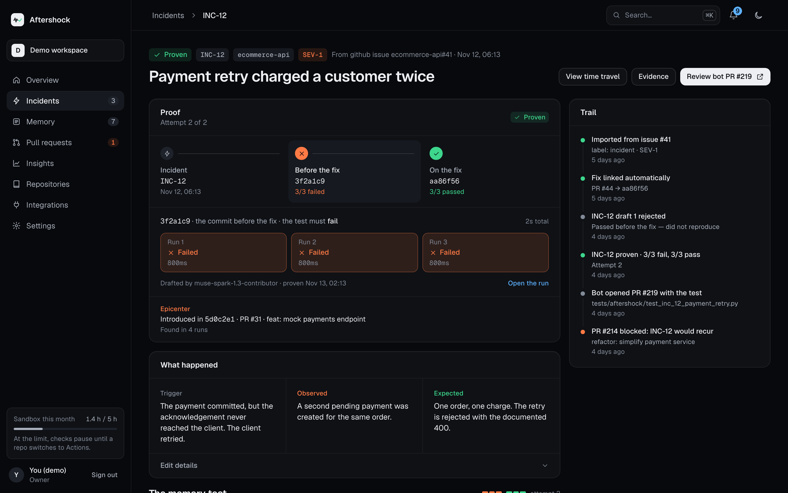

<p align="center">
  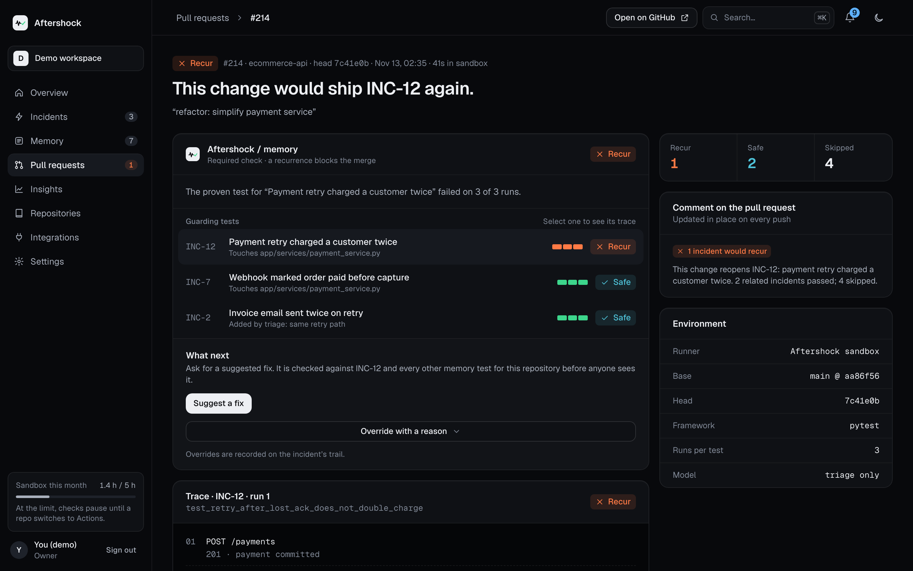
  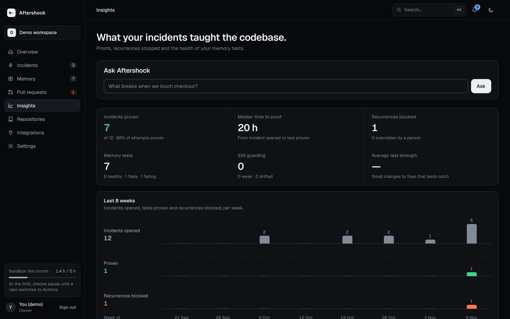
</p>

All three screens are from the demo workspace, which you can open locally (see
[Development](#development)).

<h2></h2>

### Hosted

1. **Sign in with GitHub** at [aftershock-mk.vercel.app](https://aftershock-mk.vercel.app/signin).
2. **Install the GitHub App** on the repositories you want guarded. Each installation becomes a workspace; teammates who can access it join when they sign in.
3. **Record an incident.** Label a GitHub issue `incident`, paste a postmortem, fill in the form, or connect Sentry or PagerDuty.
4. **Link the fix.** Give the fix commit or pull request, or mention the incident in the PR (`Fixes INC-12`). Time travel starts when it merges.
5. **Merge the test.** When the test is proven, Aftershock opens a pull request that adds it under `tests/aftershock/`. From then on, every pull request that could bring the bug back is checked.

No incident to hand? Fork [aftershock-sample](https://github.com/MaanavKrishna/aftershock-sample),
a small Python shop with a real bug in its history. The full walk-through is
the [Quickstart](docs/quickstart.md).

Supported: Python (pytest) and TypeScript or JavaScript (vitest, jest), plus
Go, Java and Kotlin (JUnit with Maven or Gradle), Ruby (RSpec) and Playwright
browser tests in Labs. See [Languages](docs/languages.md).

### Self-host with Docker Compose

Everything on one machine you control: the app, embedded Postgres, test runs
in Docker containers, and a daily cron. First create a GitHub App as in
[Setup](docs/setup.md), pointing its URLs at your `APP_URL`.

```bash
git clone https://github.com/MaanavKrishna/Aftershock && cd Aftershock
cp .env.example .env
# set AUTH_SECRET (32+ random characters), APP_URL, CRON_SECRET,
# the GITHUB_* and AUTH_GITHUB_* values, and a model (MODEL_API_KEY)
sudo mkdir -p /var/lib/aftershock/runs
docker compose up -d --build
```

Open `APP_URL` and sign in with GitHub. The app container talks to the host's
Docker socket, so treat the machine as dedicated to Aftershock, and back up the
`aftershock-data` volume together with `AUTH_SECRET`. The full guide is
[Self-hosting](docs/self-hosting.md); deploying to Vercel with Neon is
[Setup](docs/setup.md).

### Development

You need Node 22+. Docker Desktop or Colima is needed for real time-travel runs.

```bash
npm install
cp .env.example .env.local      # set AUTH_SECRET to 32+ random characters
npm run dev                     # http://127.0.0.1:3000
```

With `AFTERSHOCK_DEMO=1` (set in `.env.example`), the sign-in page offers a
seeded demo workspace in embedded Postgres under `./data`. No accounts are
needed.

```bash
npm run typecheck
npm test                  # unit + integration (Docker tests skip when Docker is absent)
npm run test:e2e          # Playwright; E2E_PORT picks the port (default 3000)
npm run verify            # typecheck, tests, build, CLI and audit, as CI does
```

The screenshots above come from the demo workspace, at 1440×900 in the dark
theme. To refresh them, or to capture every public and app route at 1440 and
390 wide in light and dark:

```bash
SCREENSHOTS_DIR=docs/images npx playwright test e2e/visual.spec.ts
VISUAL_SWEEP=1 SCREENSHOTS_DIR=/tmp/aftershock-shots npx playwright test e2e/visual.spec.ts
```

The graphics in this README are generated; to rebuild them, run
`pip install fonttools brotli` and then `python3 .github/readme/build.py`.

<h2></h2>


```
app/(site)        public site and docs
app/(app)         the product: incidents, time travel, memory, pull requests, insights, settings
app/api           webhooks, HTTP API (v1), MCP server, auth, cron, health
lib/domain        verdicts, admission, relevance, Epicenter: pure and unit-tested
lib/workflows     time travel, PR check, Epicenter, retro-check, nightly
lib/runner        Docker and Vercel Sandbox runners, framework adapters
lib/              also db, git, github, model, integrations, evidence, mcp, auth
components/       ui (Fault Line primitives), app, site, motion
cli/              the aftershock command line
action/           the GitHub Action that runs checks on your own runners
drizzle/          SQL migrations
scripts/          migrations, the Vercel build, demo data removal
tests/  e2e/      Vitest unit and integration tests, Playwright end to end
docs/             documentation
```

Stack: Next.js 16, React 19, TypeScript, Tailwind v4, Drizzle (Neon or PGlite),
Vercel Workflow, Vercel Sandbox, Octokit, Vitest and Playwright. More in
[Architecture](docs/architecture.md).

<h2></h2>

| Start | Use | Run | Reference |
|---|---|---|---|
| [Quickstart](docs/quickstart.md) | [Alerts and tickets](docs/integrations.md) | [Setup on Vercel](docs/setup.md) | [API and CLI](docs/api.md) |
| [Core concepts](docs/concepts.md) | [Notifications](docs/notifications.md) | [Self-hosting](docs/self-hosting.md) | [Architecture](docs/architecture.md) |
| [Languages](docs/languages.md) | [Still guarding](docs/still-guarding.md) | [Operations](docs/operations.md) | [Threat model](docs/threat-model.md) |
| | [Coding agents](docs/agents.md) | | [Design system](docs/design-system.md) |
| | [Audit evidence](docs/evidence.md) | | [Changelog](CHANGELOG.md) |

The same guides, with search, are at [aftershock-mk.vercel.app/docs](https://aftershock-mk.vercel.app/docs).

<h2></h2>

Aftershock is at v0.2.2 and runs in production at
[aftershock-mk.vercel.app](https://aftershock-mk.vercel.app). See the
[changelog](CHANGELOG.md). What it doesn't do yet:

- **GitHub only.** GitLab and Bitbucket are not supported.
- **Live third-party services.** Tests that need them can't be proven in the
  sandbox, which has no network while tests run. Run those on your own runners
  with fixtures.
- **No fix, no proof.** Incidents without a fix stay in *Awaiting fix*; nothing
  is proven by guesswork.
- **Labs.** Go, JUnit, RSpec and Playwright tests, still-guarding re-proofs,
  merge queue checks, notifications, the MCP server and most alert sources
  are opt-in per workspace under Settings → Labs.
- **Hosted capacity.** The hosted service runs on Vercel's Hobby plan, which
  caps sandbox time and snapshot storage each month. At the cap, runs end as
  *Inconclusive* with the reason; switch a repository to GitHub Actions to keep
  its checks running ([Operations](docs/operations.md)).
- **Self-hosting is single-node.** For more load, deploy to Vercel with Neon.

<h2></h2>

Bug reports, incidents Aftershock fails to prove, and new framework adapters
are the most useful contributions. Start with [CONTRIBUTING.md](CONTRIBUTING.md):
write the failing test first, keep decision logic in `lib/domain/` pure, and
run `npm run verify` before opening a pull request. Pull requests that weaken
the rules above will not be merged.

**Found a security problem?** Please report it privately. See
[SECURITY.md](SECURITY.md) and the public [threat model](docs/threat-model.md).

<h2></h2>

[Apache License 2.0](LICENSE). See also [NOTICE](NOTICE). The Geist fonts
embedded in the README graphics are under the
[SIL Open Font License 1.1](.github/readme/fonts/OFL-Geist.txt).

<br>

<a href="https://aftershock-mk.vercel.app"></a>
